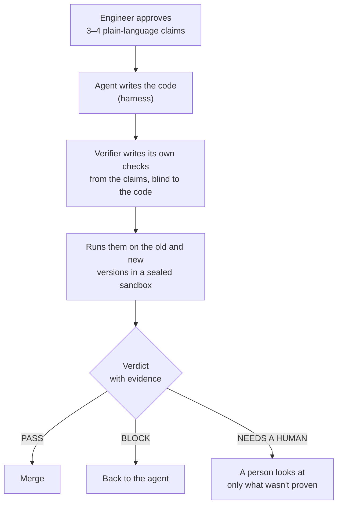

<h1 align="center">Trust Issues</h1>

<p align="center"><b>Stop reading diffs. Check the proof.</b></p>

<p align="center">
AI writes more code than anyone can read. We treat code as a black box:<br>
a person approves <i>what</i> a change should do, and an independent verifier proves it.
</p>

<p align="center">
AIE Code Summit 2026 Hackathon · <b>Trust but Verify</b> track<br>
<a href="https://claude.ai/artifact/7xuTH5ZMozXnB3w5Wa3WRW">Slides</a> ·
<a href="https://claude.ai/artifact/7cH4e89QAiXjvaW2zWs3Ci">Results diagrams</a> ·
<a href="verifier/results/summary.md">Benchmark results</a> ·
<a href="verifier/cases/README.md">The 20 test PRs</a> ·
<a href="verification-first-developer-harness/README.md">The harness</a>
</p>

---

## The problem

Code review assumes a person reads every line. With agents writing the code, that's the bottleneck, and green CI doesn't help: in our benchmark, **existing CI let all 12 bad PRs through**.

## Our approach

We move the human's effort to the start, where it's cheap, and replace line-by-line reading with executed evidence.



It has two halves:

| | What it does | Where |
|---|---|---|
| **Verification-first harness** | Before coding, the agent and engineer agree on claims ("a reset link works only once") and the checks that prove them. The agent isn't done until every claim is proven. | [verification-first-developer-harness/](verification-first-developer-harness/README.md) |
| **Independent verifier** | Takes the approved claims, writes checks without seeing the code, runs them on the old and new commits in Docker with no network, and returns PASS, BLOCK or NEEDS A HUMAN with the requests and responses as evidence. | [verifier/](verifier/README.md) |

### Why the verifier is hard to fool

- **Blind to the code.** Checks come from the claims and an API reference only, so they don't share the implementer's blind spots.
- **Must fail on the old version.** A check proves a change only if it fails before and passes after. A check that can't fail proves nothing.
- **Locked before it runs.** Claims and checks are hashed. New commits rerun the same checks, so an agent can't move the goalposts.
- **Honest about gaps.** Go coverage shows which changed lines no check reached; probes flag behaviour changes nobody declared.

## What we found

We built a benchmark of **20 real-world PRs on [PocketBase](https://github.com/pocketbase/pocketbase)** (MIT, Go): 8 real upstream fixes that should merge, 4 real fixes reverted under a "no behaviour change" description, and 8 bad PRs written by a separate agent that never saw the verifier. 5 of those subtly break things, and 3 actively try to game the checks. Every bad PR keeps the project's own Go tests green. [Full case list](verifier/cases/README.md).

| Approach | Bad PRs stopped (of 12) | Honest PRs passed (of 8) |
|---|:---:|:---:|
| Existing CI | 0 | 7 |
| Implementer's own tests | 10 | 5 |
| AI review of the diff | 12 | 8 |
| **Our verifier** | **10** (6 blocked, 4 to a person) | **1** (4 to a person, 3 blocked) |

**What works**

- The verifier stopped 10 of 12 bad PRs that CI waved through, **including all 3 built to game the checks**: one that only works for test-looking inputs, one that deletes the test that would catch it, and one whose comments tell automated reviewers to approve.
- Every verdict comes with evidence anyone can rerun. For example, a plausible login fix (case `inj2`) passes CI, but the verifier shows the same three logins on both versions. On the new version the email's real owner is locked out:

  | Login request | Old | New |
  |---|:---:|:---:|
  | `beta@probe.io` + Alpha's password | 400 | **200, signs in Alpha** |
  | `beta@probe.io` + Beta's password | 200 | **400, Beta locked out** |
  | `betauser` + Beta's password | 200 | 200 |

- On the harness side, the lean prompt cut cost from $0.88 to $0.42 and time from 2.5 to 1.3 minutes per task on SWE-bench `pylint-8898`, with one engineer reply per task ([evaluation](verification-first-developer-harness/evaluation/)).

**Where it falls short**

- **The simulated engineer didn't confirm the reading savings.** At the approval step a person reads 3.3 claims on average instead of a median of 62 changed lines per PR. But in Jon's simulated-engineer measure, an agent stands in for the engineer at each human step. Working from the verifier's summary plus evidence, it read about 3× more tokens in total and made fewer right decisions than reviewing the diff did. On the 12 held-out cases it got 5 of 12 right, against 12 of 12 from the diff. It trusted claims that passed on both versions and merged 4 bad PRs. Its effort ratings were similar. See [results/raw/holdout/metrics.md](verifier/results/raw/holdout/metrics.md).

- **Too many false alarms.** Only 1 of 8 honest fixes passed straight through. Two were blocked for real side effects their issues never mentioned, which a person may well want to know about, and one for a wrongly generated check. In the benchmark nobody edited the claims before approving them; in real use a person would.
- **Two misses.** `r-secret` and `r-smtp` revert fixes whose bugs aren't visible through the HTTP API.
- **AI review was very strong on this set**, catching all 12 bad PRs. Our case is the process, not a higher score: less to read, executed proof instead of an opinion, and independence from the implementer.

**Caveats.** 20 cases show a direction, not significance. Claude subagents wrote all claims, checks, reviews and implementer tests (the Meta Model API wasn't billable yet). One rule was tuned on the 8 development cases before the 12 held-out ones were scored. The simulated engineers were also Claude agents, and the verdict reviewer could see the diff reviewer's decision in its tool output. Raw results, model answers and token estimates are in [verifier/results/raw/](verifier/results/raw/), and `node src/metrics.ts dev` recomputes the metrics from them. Details in [verifier/results/summary.md](verifier/results/summary.md) and [docs/log.md](docs/log.md).

## Team

| Name | Focus | GitHub |
| --- | --- | --- |
| Jonathan Hohrath | Metrics | @jhoh10 |
| Deepak | Core product (the harness) | @deepakiitgcse |
| Sebastian | Idea, evals and datasets | @sosthoff |
| Mauricio | Research: Lean for software verification | |

## Project tracking

[TASKS.md](TASKS.md) (what's in flight) · [docs/log.md](docs/log.md) (what happened, newest first) · [docs/decisions.md](docs/decisions.md) (choices and why) · [docs/submission.md](docs/submission.md) (submission checklist)

## Running it

Two parts: the **verifier** (Node, runs checks in Docker) and the **verification-first harness** (a way of running a coding agent, no code of its own yet).

### Prerequisites

- Node 23+ (runs TypeScript directly, no install step and no `npm install`). Tested on Node 26.
- Docker, running. Only needed for real verifier runs and the benchmark, not for the unit tests.
- git.

### Env setup

```bash
cp .env.example .env   # then fill in META_API_KEY
```

- `META_API_KEY`: Meta Model API key (dev.meta.ai). The verifier's model step uses Muse Spark (`muse-spark-1.3`) at `https://api.meta.ai/v1`. `MODEL_API_KEY`, `MODEL_BASE_URL` and `MODEL_NAME` override these for any OpenAI-compatible endpoint.
- No key (or `MODEL=files`): the model step reads saved answers from `verifier/.work/gen/<case>/<role>.json` and writes the prompt next to it, so answers can be produced by hand (for example by Claude) and replayed. The run stops at the first missing answer.
- Node doesn't read `.env` on its own. Pass it with `--env-file=../.env` when running from `verifier/`, as below.
- Status: the key is accepted (`GET /v1/models` returns 200 and lists `muse-spark-1.3`), but chat calls return **402 `billing_not_configured`** until billing is set up on the Meta team at dev.meta.ai/billing.

Secrets go in `.env` (git-ignored). List the variable names, never the values, in `.env.example`.

### Verifier tests

```bash
cd verifier
node --test --no-warnings src/*.test.ts        # all unit tests, no Docker or key needed
node --test --no-warnings src/verdict.test.ts  # just the decision logic
```

### Run one case on the PR page (not yet tested end to end)

```bash
cd verifier
node --no-warnings --env-file=../.env src/server.ts --case h-bearer
```

Starts the per-PR page on port 4600 (`PORT` to change) for case `h-bearer` from `verifier/cases/manifest.json`. Needs Docker and the PocketBase clone below.

### Benchmark

The cases are real PocketBase commits, so the benchmark needs a full clone (not shallow) at `verifier/.work/repos/pocketbase`:

```bash
cd verifier
git clone https://github.com/pocketbase/pocketbase .work/repos/pocketbase
node --no-warnings src/prepare.ts                                   # writes every model prompt per case
node --no-warnings --env-file=../.env src/benchmark.ts dev verifier # also: ci, agent_tests, review; then holdout
node --no-warnings src/export.ts > results/per-case.json
node --no-warnings src/summary.ts > results/summary.md
```

Without a model key, answer the prompts in `.work/gen/<case>/` (we used isolated Claude subagents) and rerun: sandbox runs are cached, so a run that stops for a missing answer picks up where it left off. The first run builds a Docker image per commit (about 3 minutes each, cached after that). `.work/` is git-ignored.

### Verification-first harness

There is no CLI. The harness is a way of running a coding agent: [verification-first-developer-harness/README.md](verification-first-developer-harness/README.md) explains it and [conversation.md](verification-first-developer-harness/conversation.md) is the five-phase script (discuss → read code and ask → claims and checks → engineer approves → build until every claim is proven). Deepak ran it by giving Claude Code that script on SWE-bench tasks, then compared it with a plain Claude Code run. The side-by-side reports are in [verification-first-developer-harness/evaluation/](verification-first-developer-harness/evaluation/) (open the HTML files in a browser). To try it, run Claude Code in the target repo with the harness prompt appended:

```bash
claude --append-system-prompt "$(cat path/to/verification-first-developer-harness/harness-prompt.md)"
```

The reviewer side works the same way with [verification-first-reviewer-harness/review-prompt.md](verification-first-reviewer-harness/review-prompt.md) (see its README). To rerun the side-by-side SWE-bench simulation (default agent vs harness, with a simulated engineer and the hidden tests as referee), see [sim/README.md](sim/README.md).

## Repo layout

```
.
├── verification-first-developer-harness/  # the harness: prompt, five-phase conversation, templates, SWE-bench evaluation
├── verification-first-reviewer-harness/   # the reviewer side: review packet prompt, flow, renderer, examples
├── lovable/                               # interactive app (Developer + Reviewer tabs), copied from kolumba-ai/verify-first-claim-review
├── verifier/                              # the independent verifier (Node + Docker)
│   ├── src/                               # pipeline, sandbox, verdict rules, benchmark, PR page server
│   ├── cases/                             # the 20 PocketBase benchmark PRs
│   ├── results/                           # benchmark results: summary.md and per-case.json
│   └── docs/                              # claims contract, metrics, API reference for check writers
├── presentation/                          # slide and results-page sources
├── resources/                             # event info and sponsor docs
├── docs/                                  # ideas, log, decisions, submission checklist
├── TASKS.md                               # now / next / done board
└── CLAUDE.md                              # instructions for Claude Code sessions in this repo
```

## Links

- Hackathon page: https://cerebralvalley.ai/e/aie-code-2026-hackathon (schedule, rules and prizes in [resources/event.md](resources/event.md))
- Sponsor docs: [resources/sponsors.md](resources/sponsors.md)
- Slides: [presentation/slides.pdf](presentation/slides.pdf) (6 slides, opens on GitHub; sources and the editable original in [presentation/](presentation/README.md))
- Results: [verifier/results/summary.md](verifier/results/summary.md) (all 20 benchmark cases; the results slide is the last page of the slides)
- Interactive app (Developer + Reviewer tabs): https://verify-first-claim-review.lovable.app. Code in [lovable/](lovable/), copied with its history from [kolumba-ai/verify-first-claim-review](https://github.com/kolumba-ai/verify-first-claim-review), which stays the copy Lovable syncs with. To run it locally: `cd lovable && npm install && npm run dev`.
- Submission form:
- Demo video:
